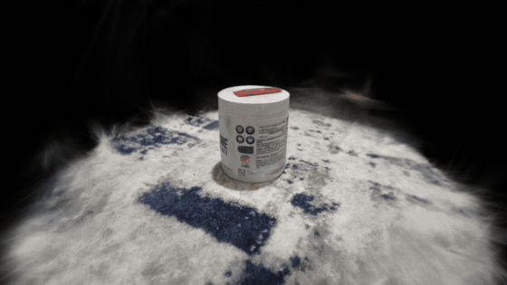
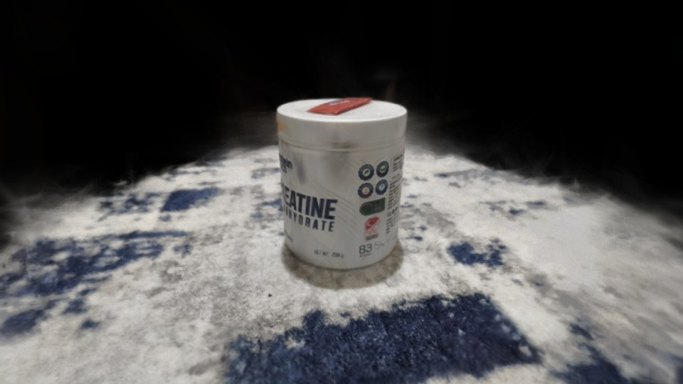
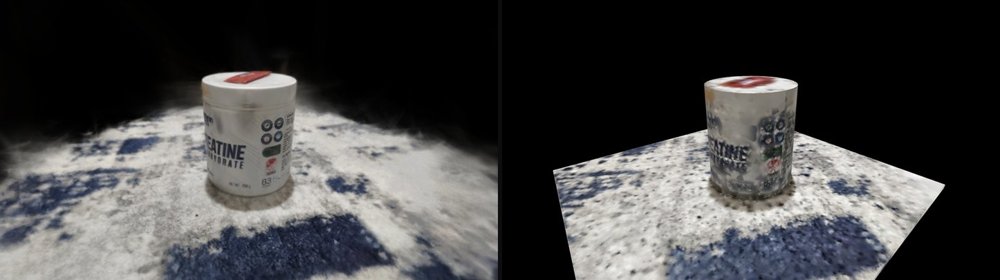
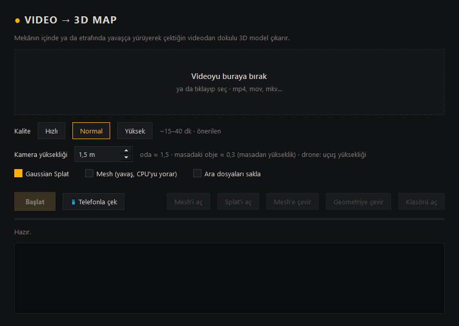

# Video → 3D Map

**English** · [Türkçe](README.tr.md)

Turn a phone video or a folder of photos into a **3D scene you can walk around in**. Everything runs
locally on your Windows PC: no uploads, no accounts, no cloud.

<p align="center">
  
</p>

<p align="center">
  <a href="https://yahyio.github.io/video-3d-map/viewer/?model=../examples/creatine-jar/output/splat.ply"><b>▶ Open the splat in your browser</b></a>
  &nbsp;·&nbsp;
  <a href="https://yahyio.github.io/video-3d-map/viewer/?model=../examples/creatine-jar/output/geometry/primitives.obj"><b>▶ Open the geometry</b></a>
</p>

## How it works

1. **Capture.** Film slowly around an object or through a room, or use the guided phone capture (below).
2. **Gaussian splat first.** COLMAP solves the camera positions, then Brush trains a
   [Gaussian splat](https://repo-sam.inria.fr/fungraph/3d-gaussian-splatting/). It looks like a photo and is
   the fastest result, so you can check whether the capture worked before spending more time on it.
3. **Convert when you like it.**
   - **Convert to mesh** runs OpenMVS at maximum quality and gives a textured `model.obj`. The frames and
     camera solve are reused, so they are not computed again.
   - **Convert to geometry** fits simple textured shapes (cylinders and boxes) to the splat in seconds.
     This gives clean, light geometry instead of a noisy scan.

| Gaussian splat | Splat vs. textured geometry (same viewpoint) |
|---|---|
|  |  |

The example above is in [`examples/creatine-jar`](examples/creatine-jar/output). It was cropped to the
object and reduced to the base colour band so it stays small enough for the web.

## Features

- **Drag and drop** a video (`mp4`, `mov`, `mkv`, …) or a folder of photos. Blurry frames are dropped and
  the sharpest frame is picked per time window.
- **Guided phone capture over your own Wi-Fi.** Scan a QR code and the phone becomes a capture tool:
  - A ring shows which angles you have covered.
  - It takes photos by itself when the phone is steady and looking somewhere new.
  - It gives directions like "walk right" or "tilt the phone down" and warns when it is too dark.
  - Photos go straight to your PC and nothing leaves your network.
- **Fits the memory you have.** The number of frames and the training resolution are chosen so that Brush
  fits in free memory.
- **Tiled full-resolution training for large scenes.** When a scene has too many frames for RAM, it is split
  into overlapping tiles on the floor plan. Each tile trains at full resolution, and the tiles are merged
  into one splat. A run that stops halfway continues from the last finished tile.
- **Upright and metric.** The floor ends up at `y = 0`, and the scale in metres comes from how high you held
  the camera.
- **Built-in 3D viewer** (three.js + [Spark](https://sparkjs.dev)):
  - orbit the model, or walk through it with WASD;
  - press N/P to jump between the original capture viewpoints;
  - wireframe and grid toggles.

## Requirements

- Windows 10/11 x64
- Python 3.10+
- 16 GB RAM recommended
- An NVIDIA GPU is recommended: COLMAP's CUDA build is used when `nvidia-smi` is found. Brush runs on any
  modern GPU.
- A few GB of free disk space per scan while it runs. Intermediate files are removed when the scan is done.

## Setup

```bash
git clone https://github.com/yahyio/video-3d-map
cd video-3d-map
pip install -r requirements.txt
python setup_tools.py
```

`setup_tools.py` downloads the engines from their official GitHub releases into `tools/`:

- COLMAP 4.2.0
- OpenMVS 2.4.0
- Brush 0.3.0
- ffmpeg, only if it is not already on your `PATH`

Use `--no-cuda` for machines without an NVIDIA GPU.

Start the app with `Baslat.bat` or `python app.py`. You can also drop a video onto `Baslat.bat`.
The interface is in Turkish; the main buttons are:

| Button | Meaning |
|---|---|
| **Başlat** | Start |
| **Telefonla çek** | Capture with phone |
| **Splat'i aç** / **Mesh'i aç** | Open splat / open mesh |
| **Mesh'e çevir** | Convert to mesh |
| **Geometriye çevir** | Convert to geometry |
| **Kalite: Hızlı / Normal / Yüksek** | Quality: fast / normal / high |



## How to film

| Do | Don't |
|---|---|
| Move **slowly**: 1–2 seconds per step | Spin on the spot (the worst case) |
| Keep the camera at a constant height and **move sideways** | Only walk forwards |
| See every spot from 2–3 different angles | Look at a spot only once |
| Bright, even light | Dark rooms, glowing screens, mirrors, glass |
| Object: walk around it twice, once high and once low | Move the object while filming |

**Don't send the video through WhatsApp, Telegram or Instagram.** They shrink it (e.g. to 478×850) and the
result gets much worse. Copy the original file over a cable or from cloud storage. The app warns you when a
video is low resolution.

## Outputs

Each scan is saved to `projects/<name>_<date>/output/`:

- `splat.ply` + `splat_frame.json`: the Gaussian splat (standard 3DGS PLY) and the transform that makes it
  upright and metric.
- `model.obj` + `.mtl` + textures: the textured mesh, if you chose Mesh. Units are metres, Y is up and the
  floor is at y = 0.
- `geometry/primitives.obj`: the textured shapes from **Convert to geometry**.
  `primitives.json` lists them with their centre, size and rotation.
- `info.json`: frame count, triangle count, estimated size and run time.

| | Mesh (`model.obj`) | Splat (`splat.ply`) |
|---|---|---|
| Looks like | Textured surface, flat light | A photo |
| Dark rooms, RGB lights, screens | Poor | Good |
| Game engines, Blender | Yes | Needs a splat plugin |
| Any viewing angle | Yes | Best near where you filmed |

## Viewer controls

| Input | Action |
|---|---|
| Drag / right-drag / wheel | Rotate / pan / zoom |
| **F** | Walk mode: WASD to move, Q/E for down/up, Shift to go faster |
| **N** / **P** | Next / previous capture viewpoint |
| **T** / **G** / **R** | Wireframe / grid / recentre |

## Scale

A single video can't know its real size. The app estimates the scale from the camera height you enter:

- about **1.5 m** when filming by hand while standing;
- about **0.3 m** above the table for a small object on a table;
- the flight height for a drone.

## Development

```bash
python -m unittest discover tests
python tests/fixtures/make_room_video.py room.mp4   # synthetic room with known dimensions, for end-to-end runs
```

| Path | What it does |
|---|---|
| `core/pipeline.py` | Runs the stages, resume and convert |
| `core/frames.py`, `core/photos.py` | Frame extraction and sharpness selection |
| `core/sfm.py`, `core/retrieval.py` | COLMAP: features, pair selection, mapping |
| `core/splat.py`, `core/tiles.py` | Brush training, memory planning, tiled training |
| `core/mvs.py`, `core/mesh_clean.py`, `core/orient.py` | OpenMVS mesh, cleanup, upright/metric frame |
| `core/primitives.py`, `core/bake.py` | Shape fitting and texture baking |
| `capture/` | Guided phone capture (local HTTPS server and web app) |
| `viewer/` | Browser viewer |

## Credits

This app drives these projects. They are downloaded from their own releases and not redistributed here:

- [COLMAP](https://github.com/colmap/colmap) (BSD)
- [OpenMVS](https://github.com/cdcseacave/openMVS) (AGPL-3.0)
- [Brush](https://github.com/ArthurBrussee/brush) (Apache-2.0)
- [FFmpeg](https://ffmpeg.org) (GPL build)
- [three.js](https://threejs.org) (MIT)
- [Spark](https://github.com/sparkjsdev/spark) (MIT)

## License

[MIT](LICENSE)
