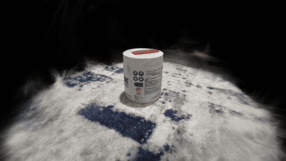
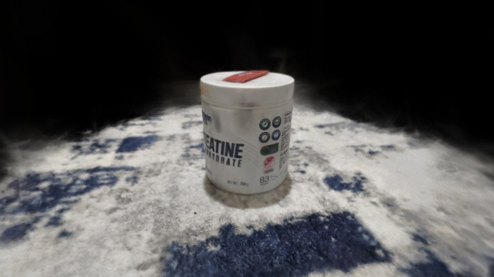
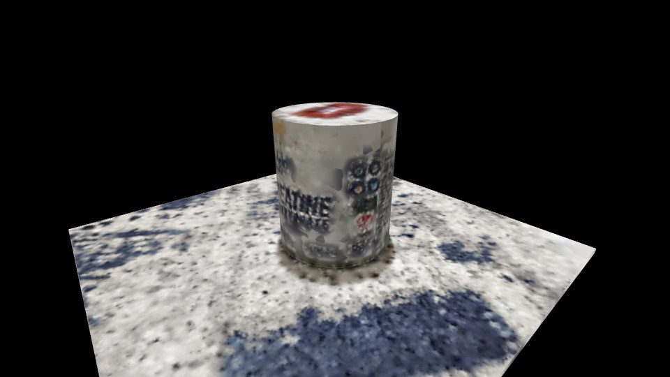
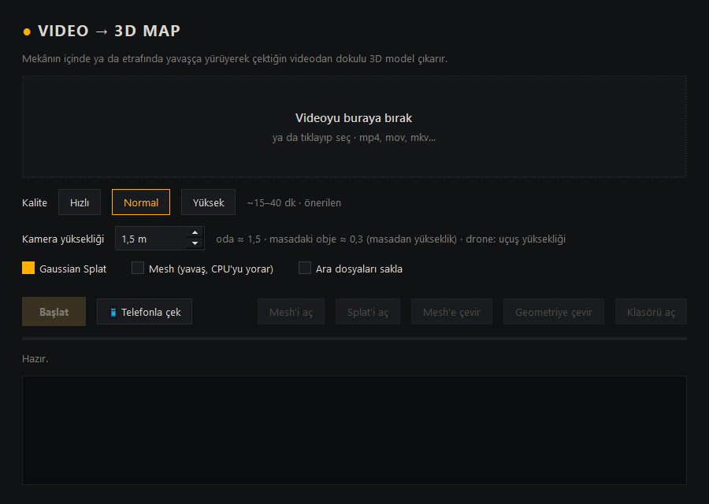

# Video → 3D Map

[English](README.md) · **Türkçe**

Telefonla çektiğin bir videoyu ya da fotoğraf klasörünü **içinde gezebileceğin bir 3D sahneye** çevirir.
Her şey kendi Windows bilgisayarında çalışır: yükleme, hesap ya da bulut yok.

<p align="center">
  
</p>

<p align="center">
  <a href="https://yahyio.github.io/video-3d-map/viewer/?model=../examples/creatine-jar/output/splat.ply"><b>▶ Splat'i tarayıcıda aç</b></a>
  &nbsp;·&nbsp;
  <a href="https://yahyio.github.io/video-3d-map/viewer/?model=../examples/creatine-jar/output/geometry/primitives.obj"><b>▶ Geometriyi aç</b></a>
</p>

## Nasıl çalışır

1. **Çek.** Bir nesnenin etrafında ya da odanın içinde yavaşça dolaşarak video çek. İstersen aşağıdaki
   rehberli telefon çekimini kullan.
2. **Önce Gaussian splat.** COLMAP kamera konumlarını çözer, Brush bir
   [Gaussian splat](https://repo-sam.inria.fr/fungraph/3d-gaussian-splatting/) eğitir. Fotoğraf gibi görünür
   ve en hızlı sonuçtur. Böylece daha fazla zaman harcamadan önce çekimin tuttuğunu görürsün.
3. **Beğenirsen çevir.**
   - **Mesh'e çevir:** OpenMVS'i en yüksek kalitede çalıştırır ve dokulu bir `model.obj` verir. Kareler ve
     kamera konumları yeniden hesaplanmaz.
   - **Geometriye çevir:** splat'e birkaç saniyede basit, dokulu şekiller (silindir ve kutu) oturtur.
     Gürültülü tarama yerine temiz ve hafif bir geometri elde edersin.

| Gaussian splat (254 bin splat) | Geometriye çevir (2 şekil, 204 üçgen) |
|---|---|
|  |  |

Yukarıdaki örnek [`examples/creatine-jar`](examples/creatine-jar/output) klasöründe. Web'de hızlı açılsın
diye nesnenin çevresine kırpıldı ve yalnızca temel renk bandı bırakıldı.

## Özellikler

- Videoyu (`mp4`, `mov`, `mkv`, …) ya da bir fotoğraf klasörünü **sürükleyip bırak**. Bulanık kareler
  atılır, her zaman aralığından en net kare seçilir.
- **Kendi Wi-Fi'ın üzerinden rehberli telefon çekimi.** QR kodu okuttuğunda telefon bir çekim aracına dönüşür:
  - Bir halka, hangi açılardan çektiğini gösterir.
  - Telefon sabit durup yeni bir yere baktığında fotoğrafı kendisi çeker.
  - "Sağa doğru yürü", "telefonu aşağı eğ" gibi yönlendirmeler yapar, ortam çok karanlıksa uyarır.
  - Fotoğraflar doğrudan bilgisayara gider, ağından dışarı hiçbir şey çıkmaz.
- **Belleğe göre ayarlanır.** Kare sayısı ve eğitim çözünürlüğü, Brush boş belleğe sığacak şekilde seçilir.
- **Büyük sahnelerde parça parça, tam çözünürlükte eğitim.** Kare sayısı RAM'e sığmayacak kadar çoksa sahne,
  zemin planında birbiriyle örtüşen parçalara bölünür. Her parça tam çözünürlükte eğitilir, sonra hepsi tek
  bir splat'te birleşir. Yarıda kalan bir iş, son biten parçadan devam eder.
- **Dik ve metre ölçekli.** Zemin `y = 0`'a oturur. Ölçek, kamerayı ne kadar yüksekte tuttuğundan hesaplanır.
- **Dahili 3D görüntüleyici** (three.js + [Spark](https://sparkjs.dev)):
  - modeli döndür ya da WASD ile içinde yürü;
  - N/P ile çekimin yapıldığı kamera açılarına atla;
  - tel kafes ve ızgara görünümünü aç/kapat.

## Gereksinimler

- Windows 10/11 x64
- Python 3.10+
- 16 GB RAM önerilir
- NVIDIA ekran kartı önerilir: `nvidia-smi` bulunursa COLMAP'in CUDA sürümü kullanılır. Brush her modern
  ekran kartında çalışır.
- Tarama sürerken birkaç GB boş disk. Ara dosyalar iş bitince silinir.

## Kurulum

```bash
git clone https://github.com/yahyio/video-3d-map
cd video-3d-map
pip install -r requirements.txt
python setup_tools.py
```

`setup_tools.py`, motorları kendi resmi GitHub sürümlerinden `tools/` klasörüne indirir:

- COLMAP 4.2.0
- OpenMVS 2.4.0
- Brush 0.3.0
- ffmpeg, yalnızca `PATH`'te yoksa

NVIDIA ekran kartı olmayan bilgisayarlarda `--no-cuda` ile çalıştır.

Uygulamayı `Baslat.bat` ile ya da `python app.py` ile aç. Videoyu doğrudan `Baslat.bat`'ın üzerine de
sürükleyebilirsin.



## Telefonla rehberli çekim (önerilen)

Fotoğraf, videodan daha iyi sonuç verir: telefon fotoğrafları yaklaşık 12 MP ve bulanıksızdır.

1. **📱 Telefonla çek**'e bas. Tarayıcıda bir QR kod açılır.
   - Windows "Python'un ağda iletişim kurmasına izin ver" diye sorarsa **Özel ağlar** için izin ver.
2. Telefon aynı Wi-Fi'da olsun. QR'ı okut ve bağlantıyı **Chrome**'da aç.
3. "Bağlantınız gizli değil" uyarısında **Gelişmiş → yine de devam et** de. Sertifika senin bilgisayarında
   üretildi.
4. Kamera ve hareket izinlerini ver. **Bir şeyin etrafında** ya da **Oda içi** modunu seç.
5. Halkalar dolana kadar rehberi takip et, sonra **Bitir ve işle**'ye bas.

## Nasıl çekilir

| Yap | Yapma |
|---|---|
| **Yavaş** hareket et: bir adım 1–2 saniye sürsün | Olduğun yerde dönme (en kötüsü) |
| Kamerayı sabit yükseklikte tut, **yana kayarak** çek | Sadece ileri yürüme |
| Her yeri 2–3 farklı açıdan gör | Aynı yere tek bakış |
| Aydınlık, düzgün ışık | Karanlık, parlayan ekranlar, ayna, cam |
| Nesne: etrafında 2 tur at, biri yüksekten biri alçaktan | Çekim sırasında nesneyi oynatma |

**Videoyu WhatsApp, Telegram ya da Instagram üzerinden gönderme.** Bu uygulamalar videoyu küçültür (ör.
478×850) ve sonuç çok kötüleşir. Orijinal dosyayı kabloyla ya da bulut depolama üzerinden aktar. Program
düşük çözünürlüklü videoda seni uyarır.

## Çıktılar

Her tarama `projects/<ad>_<tarih>/output/` altına kaydedilir:

- `splat.ply` + `splat_frame.json`: Gaussian splat (standart 3DGS PLY) ve onu dik, metre ölçekli hale
  getiren dönüşüm.
- `model.obj` + `.mtl` + dokular: Mesh seçtiysen dokulu model. Birim metre, Y yukarı, zemin y = 0'da.
- `geometry/primitives.obj`: **Geometriye çevir** ile çıkan dokulu şekiller. `primitives.json` her birinin
  merkezini, boyutunu ve dönüşünü listeler.
- `info.json`: kare sayısı, üçgen sayısı, tahmini boyut ve süre.

| | Mesh (`model.obj`) | Splat (`splat.ply`) |
|---|---|---|
| Görünüş | Dokulu yüzey, düz ışık | Fotoğraf gibi |
| Karanlık oda, RGB ışık, ekran | Kötü | İyi |
| Oyun motorları, Blender | Evet | Splat eklentisi gerekir |
| Her açıdan bakılabilir | Evet | En iyi, çekim yapılan yerlere yakın açılardan |

## Görüntüleyici kontrolleri

| Giriş | Ne yapar |
|---|---|
| Sürükle / sağ tıkla sürükle / tekerlek | Döndür / kaydır / yakınlaş |
| **F** | Yürüme modu: WASD ile yürü, Q/E ile in/çık, Shift ile hızlan |
| **N** / **P** | Sonraki / önceki çekim açısı |
| **T** / **G** / **R** | Tel kafes / ızgara / ortala |

## Ölçek

Tek bir videodan gerçek boyut bilinemez. Program, girdiğin kamera yüksekliğinden ölçeği tahmin eder:

- ayakta, elde çekimde yaklaşık **1,5 m**;
- masadaki küçük bir nesne için masadan yaklaşık **0,3 m**;
- drone çekiminde uçuş yüksekliği.

## Geliştirme

```bash
python -m unittest discover tests
python tests/fixtures/make_room_video.py room.mp4   # ölçüleri bilinen sentetik oda, uçtan uca deneme için
```

## Teşekkürler

Uygulama şu projeleri çalıştırır. Hepsi kendi sürümlerinden indirilir, bu depoda dağıtılmaz:

- [COLMAP](https://github.com/colmap/colmap) (BSD)
- [OpenMVS](https://github.com/cdcseacave/openMVS) (AGPL-3.0)
- [Brush](https://github.com/ArthurBrussee/brush) (Apache-2.0)
- [FFmpeg](https://ffmpeg.org) (GPL derlemesi)
- [three.js](https://threejs.org) (MIT)
- [Spark](https://github.com/sparkjsdev/spark) (MIT)

## Lisans

[MIT](LICENSE)
